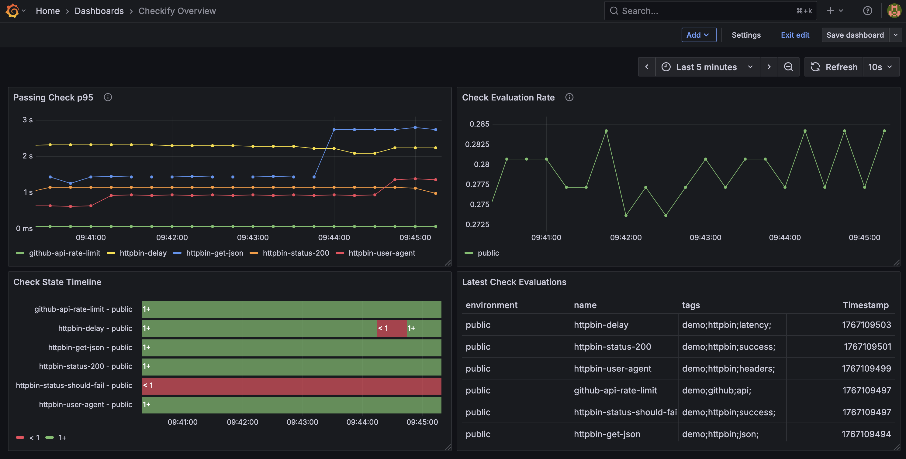

Declarative HTTP, TCP, and ping checks in YAML with multi-environment support. Check metrics can be scraped with Prometheus for visualization and alerting in Grafana. 

See [demo/README.md](demo/README.md) for a demo.

## Features

- **Declarative YAML Configuration**: Define checks with endpoints, assertions, and intervals in YAML.
- **Multiple Check Types**: HTTP, TCP, and ping checks supported.
- **Multi-Environment Support**: Run the same checks across prod, stage, dev, etc.
- **Powerful Assertions**: Uses [CEL](https://github.com/google/cel-go) for asserting responses.
- **Monitoring Integration**: Check results are logged to stdout in JSON format and exposed as Prometheus metrics.

## Configuration

See [CONFIGURATION](docs/CONFIGURATION.md) for detailed configuration instructions.

## Commands

- `evaluator` - Run checks at their configured interval (default)
- `evaluate-once <check-name>` - Run a specific check once
- `validate` - Validate configuration file

## Contributing

See [CONTRIBUTING](docs/CONTRIBUTING.md) for details.
